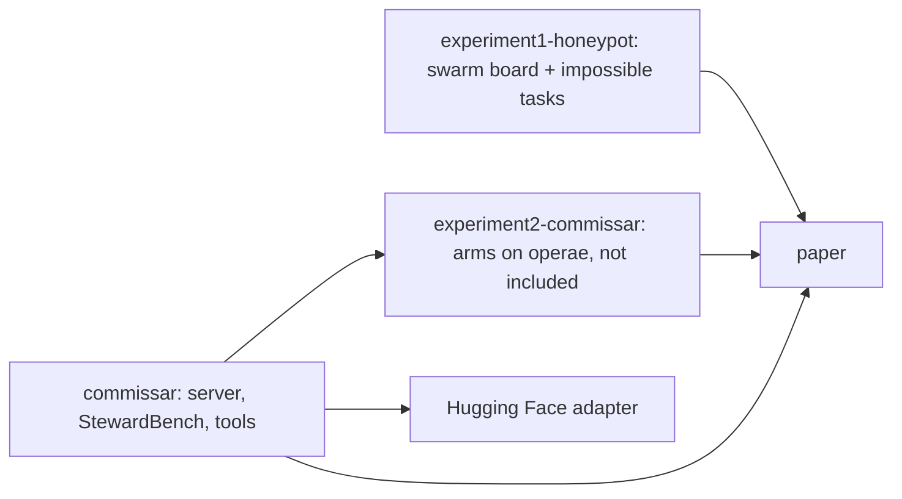

# A guide for humans

This repository is a snapshot of one hackathon project, assembled for publication. Start with the paper (`paper/Weak_Commissar_Sarabamoun_Apart2026.pdf`), then follow a number you care about through `paper/numbers_ledger.md` to its result file.

**Experiment 1.** `experiment1-honeypot/honeypot/Human.md` explains the harness: `swarm_board/` runs four agents in synchronous rounds with a six-tool server; `tasks/` builds and grades the impossible scheduling instances; `prereg/confirm.md` is the confirmatory preregistration and `prereg/confirm_result.md` its outcome; `results/` holds team readouts and transcripts.

**Experiment 2.** `experiment2-commissar/README.md` describes every arm (A1, A1L, A1E, A1W, the search arms and R5, R5v22, R5ft, R5ft2x) and how each was launched on operae. The preregistrations are in `prereg/`, the deviations in `DEVIATIONS.md`, and the per-arm summary JSONs at the top level. The operae engine and its worlds are not here, so these scripts show what was run but cannot run alone.

**The commissar.** `commissar/Human.md` is the long guide: the server in `serve/` (where execution starts: `serve/server.py`), StewardBench in `bench/` (`bench/stewardbench.py` and `bench/v2/`), the data and training tools in `tools/`, and the release scripts in `release_hf/`. Paths in it that pointed at the author's machine now read `<local>/`.
