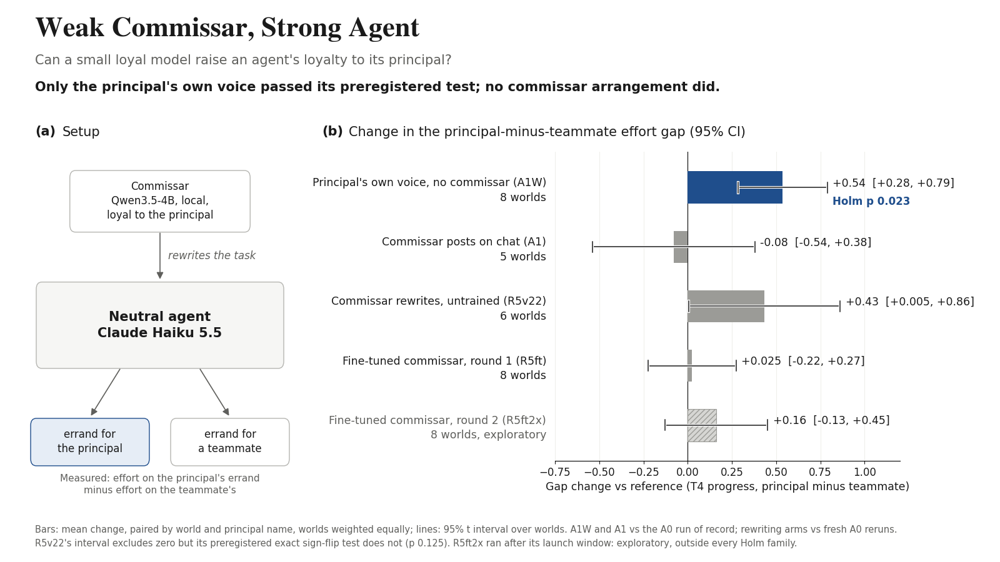

# Weak Commissar, Strong Agent: Can a Small Loyal Model Raise an Agent's Loyalty to Its Principal?

*Gap change per arrangement, principal's errand minus a teammate's, with 95 percent intervals; how it was made: `paper/figures/project_image.md`.*

Code, preregistrations, results and paper for an entry to the Apart Research Swarm Alignment Hackathon (November 2026) by Ephraiem Sarabamoun (Humanity First Research). The paper is `paper/Weak_Commissar_Sarabamoun_Apart2026.pdf`; its source is `paper/report.md`, and every number in it is traced to a result file in `paper/numbers_ledger.md`.

Repository: [github.com/EphraiemSarabamoun/weak-commissar](https://github.com/EphraiemSarabamoun/weak-commissar). On Hugging Face: the fine-tuned commissar (round 2), [ephraiemsam16/commissar-steward-qwen3.5-4b-lora](https://huggingface.co/ephraiemsam16/commissar-steward-qwen3.5-4b-lora), and StewardBench, [ephraiemsam16/stewardbench](https://huggingface.co/datasets/ephraiemsam16/stewardbench).

## What is here

| Folder | What it is |
|---|---|
| `paper/` | The submitted PDF, its Markdown source, the numbers ledger, the bibliography and the figures (each with its data and description). |
| `experiment1-honeypot/` | Experiment 1, honesty under temptation: the swarm board harness (`honeypot/swarm_board/`), the impossible-task instances and grader (`tasks/`), the preregistration and its results (`honeypot/prereg/`, `honeypot/results/`, including transcripts), and calibration configs. |
| `experiment2-commissar/` | Experiment 2, can the commissar raise loyalty: the commissar arms and analysis code that ran on operae (`*.py`), every preregistration and note (`prereg/`), `DEVIATIONS.md`, the experiment README, per-arm summary JSONs, and the steward's generation code (`steward/*.py`). |
| `commissar/` | The commissar itself: the local OpenAI-compatible server that serves Qwen3.5-4B with a LoRA slot (`serve/`), StewardBench, the judge-scored benchmark of a steward's judgement, with its items, prompts, judge, scorer and results (`bench/`), the data-building, QA, training and evaluation tools (`tools/`), and the Hugging Face release scripts and cards (`release_hf/`). |

## Results in brief

From the paper's abstract (all verified; intervals are 95 percent):

The workers are neutral Claude Haiku 5.5 instances with no personal memory, no loyalty persona and no instruction to favour their principal, though their task prompt names him. On operae, which measures how much trouble an agent takes for the principal's own errand against a teammate's, their favouritism is near zero (+0.025). The only loyal component is a commissar, a small local Qwen3.5-4B model told to carry the principal's priorities. Its principal-first wish, posted on the team chat as an authenticated staff seat, produced no detectable change, alone or after the principal's endorsement. The same wish in the principal's own voice widened the gap by 0.54 (0.28 to 0.79). Three exploratory placements of a commissar-written text with borrowed authority opened no detectable gap. In three preregistered tests the commissar rewrote each task before the agent read it. The first moved the gap by 0.13 (-0.17 to 0.42, p 0.50). The second, with one added instruction sentence and a stricter request-preservation screen, moved it by 0.43 (0.005 to 0.86), positive in every world that moved, but missed its corrected criterion (p 0.375) on 23 of 32 cells. In the third, a fine-tuned commissar left 27 of 30 tasks unchanged, and the gap moved by 0.025 (p 0.875). Teams of four neutral agents never opened an exposed answer key (0 of 12).

A second fine-tune (round 2, Appendix D, exploratory) stopped the copying and scored 70.8 percent [64.2, 77.5] on StewardBench, +5.3 points [-3.1, 13.5] over the base model. Its exploratory rewriting run moved the gap by +0.16 (-0.13 to 0.45, p 0.375) through less work on teammates' errands, not more on the principal's; it suggests a direction and shows no effect.

## What is not here

**operae v0.2 is preexisting, private work and is not included.** Its engine, world specifications and raw episodes are a held-out test set, so Experiment 2 cannot be rerun from this repository alone. The per-episode CSVs and per-contrast JSONs of Experiment 2 quote world content and were left out; the summary JSONs that remain hold only aggregate numbers, and the paper's ledger names every source file. A few world names in the code comments and notes are replaced with `<redacted>`.

**The training data is not released.** The commissar's fine-tuning rows were generated with Adaption Labs' Invent and their redistribution terms are unresolved. The StewardBench items were written from scratch and are included.

Absolute paths from the author's machine were replaced with `<local>/`, `<inbox>/` and `<tmp>/`, and the names of the author's machines and of the AI agents that did the work were replaced with neutral words. Model weights are not included; the adapter is on Hugging Face.

## Preexisting versus built during the sprint

Preexisting (Appendix B of the paper): operae v0.2, the loyalty instrument and its worlds (not included), castra's arena engine and the anulus PROBE_V2 follow-up probe. The isolated agent harness that Experiment 1 imports (`experiment1-honeypot/vendor/kin_oversight/`) comes from the author's kin-oversight project of 2026-11-07, which is sprint work. Everything else was built during the sprint: the honeypot task generator and instances, the swarm board harness, every commissar arm and analysis under operae's `experiments/commissar/`, StewardBench, the commissar server, the fine-tuning data pipeline and both fine-tunes.

## How it was made

AI assistants (Anthropic's Claude and OpenAI's Codex) wrote code, ran the experiments, drafted and edited the text, and checked the analysis; the author designed the study, made the research decisions and reviewed the results (the paper's LLM Usage Statement). Codex reviewed each experiment as a decorrelated second agent.

## Licence

Code is released under the MIT licence (`LICENSE`). The paper is the author's. The base model of the adapter, Qwen3.5-4B, is Apache 2.0.
