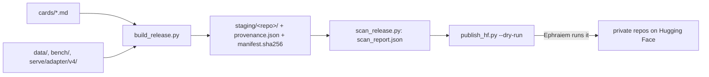

# release_hf: the Hugging Face release, staged but not uploaded

This folder prepares three Hugging Face repos under `ephraiemsam16`. The two datasets follow his `<name>-private` convention and stay private (the Adaption-terms question is open). The model is public on his word of 2026-11-09 02:49: `publish_hf.py --make-public` uploads it private, verifies every file by downloading it back, and only then makes it public; it refuses to make a dataset public.

| Repo | Type | Contents | Source in this repository |
|---|---|---|---|
| `commissar-sft-private` | dataset | the v4 training and holdout rows, the row index, the build report, the three Invent prompts | `data/steward_sft_v4_*`, `data/invent_prompt_v3*.txt`, `data/invent_prompt_v4_rewrite.txt` |
| `stewardbench-private` | dataset | items and validation sets of v1 and v2, the steward prompts, the judge prompts (extracted and checked against the pinned sha256), the pin files | `bench/`, `bench/v2/` |
| `commissar-steward-qwen3.5-4b-lora` (public) | model | the round-2 LoRA adapter (`base_model_name_or_path` set to `Qwen/Qwen3.5-4B`, recorded in provenance), its card, the training request and recipe, and the two prompts it was evaluated with | `serve/adapter/v5/`, `runs/20261109T091848Z_train/`, `data/commissar_prompt_v2_2.txt`, `tools/qa/rewrite_rows.py` |

## Flow



`build_release.py` copies every file byte for byte, except the pin files, whose one local path prefix becomes `<local>/` (recorded in `provenance.json`). `scan_release.py` reads every staged file for secret-shaped tokens, host paths, fleet names and addresses, emails, the author's and the pod's names, and, in the training rows, every person, organisation, email domain, canary and world id of operae's test worlds and every StewardBench principal and organisation. Secrets, host paths, fleet names or addresses and any operae or StewardBench name fail it; the rest are listed for a human to review. Two exemptions are recorded in the report: a `.safetensors` file is scanned as its JSON header only (its body is raw weights), and a `tokenizer.json` skips its vocabulary and merges only when both equal the base model's. `publish_hf.py` re-checks the manifests, re-runs the scan, refuses the model repo while its card has a `{{FILL: ...}}` slot or the adapter weights are missing, creates each repo private, stops if one reads as public, uploads, and verifies every file against its manifest by downloading it back.

## Commands

```bash
cd <local>/projects/commissar
python3 release_hf/build_release.py && python3 release_hf/scan_release.py
python3 release_hf/publish_hf.py --dry-run
# Ephraiem, when he decides: the two datasets now, the model once its card is filled and the adapter is staged
uv run --no-project --python 3.12 --with huggingface_hub python release_hf/publish_hf.py --skip-model
uv run --no-project --python 3.12 --with huggingface_hub python release_hf/publish_hf.py --only commissar-steward-qwen3.5-4b-lora --make-public
```

The token is `HF_TOKEN` from the environment or from `<local>/.zshrc.secrets`; no script prints it. `staging/` and `scan_report.json` are regenerated and git-ignored.

## Open before publishing

The dataset licence waits on Adaption's terms for Invent-generated data: the terms page at adaptionlabs.ai/terms-of-service could not be read in full by a fetch, and the only statement found (adaptionlabs.ai/llms.txt) permits commercial use of Invent API datasets for downstream model training without addressing redistribution. The model card is filled from the Codex-verified round-2 results (the paper's Appendix D).
